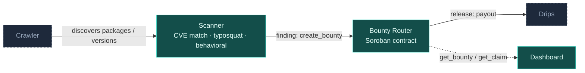

# DepRadar

**A decentralized security scanner for open-source dependency graphs — funded bounties, not empty advisories.**

## Mission

DepRadar crawls open-source package registries, scans dependency graphs for
known vulnerabilities, maintainer-account takeovers, and typosquatting, and
pays out bounties through [Drips](https://www.drips.network/) to whoever
catches the issue first — verifiably, on-chain, without a foundation or a
platform sitting between the finder and the payout.

Common architectural, claim lifecycle, and network questions are answered in the [FAQ](docs/FAQ.md).

## Architecture

**Solid teal** = live / substantially complete.  **Dashed** = planned — see
[Status & Roadmap](#status--roadmap).

- **Crawler** walks registries (npm, PyPI, crates.io, and others as modules
  land) for new packages, new versions, and metadata changes.
- **Scanner** evaluates what the crawler surfaces against three detection
  classes: known-CVE matching, typosquat similarity, and behavioral
  analysis (install scripts, obfuscation, anomalous permission requests).
  The typosquat subsystem is substantially complete — popular-package
  reference dataset, Levenshtein edit-distance scorer, homoglyph signal, and
  a combined scoring API that ties all three signals into a single
  `score_package()` call (`src/typosquat/`). CVE matching has its first
  module too: an OSV API client (`src/cve/osv_client.rs`) that queries
  [osv.dev](https://osv.dev) for a pinned package version. What remains is
  the crawler wiring that feeds real package names into these scorers.
- **Bounty Router** is the Soroban smart contract in this repo
  (`contracts/deprader_router/`). It's the trust boundary: it locks funds
  against a finding, records who claimed it, and pays out — independent of
  which crawler or scanner module produced the finding.
- **Drips** handles the actual payout distribution once a bounty is
  released.
- **Dashboard** (`frontend/`) is a read-only React app over the contract's
  public state (`bounty_count` / `get_bounty` / `get_claim`). It lists every
  bounty and its claims, holds no authority, and needs no wallet. Run it
  with `cd frontend && npm ci && npm run dev`.

## Live on Testnet

The router contract is deployed and has completed a full bounty lifecycle
on Stellar testnet:

**Contract ID:** [`CCPRQANY467KKE4ROKCNW6TH3LY3EPVFRXIXJ5V4VCYHLJKWZPOZYQJQ`](https://stellar.expert/explorer/testnet/contract/CCPRQANY467KKE4ROKCNW6TH3LY3EPVFRXIXJ5V4VCYHLJKWZPOZYQJQ)

A one-time `initialize(admin)` call at deploy time sets the admin who
reviews claims. Bounty IDs are assigned by the contract, and every state
change emits an event (`created`, `claimed`, `rejected`, `released`,
`cancelled`, `admin_set`) so indexers and dashboards can follow along
without polling.

1. **`create_bounty(creator, issue_ref, amount, token, deadline) -> bounty_id`**
   — locks `amount` of `token` from `creator` against the finding described
   by `issue_ref`, open for claims until `deadline`. Funds move into the
   contract here.
2. **`submit_claim(bounty_id, claimant, proof_ref) -> claim_id`** — records a
   claim with a reference to the proof (a PR, advisory or writeup). Moves no
   funds. Any number of researchers can claim the same bounty (one claim
   per address, capped at 50), so a junk claim submitted first can't block
   the real finder.
3. **`reject_claim(bounty_id, claim_id)`** — admin-only. Marks a bad claim
   rejected; the bounty stays open for the others.
4. **`release(bounty_id, claim_id)`** — admin-only, once per bounty. Pays the
   locked funds to the chosen claimant and closes the bounty. Still works
   after the deadline, so in-time claims can be paid during review.
5. **`cancel_bounty(caller, bounty_id)`** — refunds the creator. The admin
   can cancel at any time; the creator can cancel once the deadline has
   passed with no pending claims, or once a 7-day review window after the
   deadline has also passed. Funds can never be locked forever, and a
   creator can't pull them out from under a claimant awaiting review.

The admin can be rotated with a two-step `propose_admin` / `accept_admin`
handshake. `get_bounty`, `get_claim`, `get_claim_id`, `bounty_count` and
`get_admin` expose the full state at every step, so anyone can verify a
bounty without trusting a dashboard or API — the
[testnet read client](client/) does exactly that.

The lifecycle above was run end-to-end against the live contract,
including the case the original single-claim design couldn't handle: a
junk claim lands first, the admin rejects it, and the real finder is paid
([release tx](https://stellar.expert/explorer/testnet/tx/69538e183dab1799c92be7231e562fcbca47bd32e0247a44f0cddfbeaee84cb0)).

## Why This Matters

Software supply chain compromise isn't a hypothetical: the `event-stream`
backdoor, the `ua-parser-js` account takeover, and the `xz-utils`
long-con backdoor all reached production systems by exploiting the same
weak point — a compromised or abandoned maintainer identity slipping a
malicious change past a dependency graph nobody was actively watching.
Typosquatting attacks on npm and PyPI follow the same pattern at higher
volume and lower sophistication, betting that an install-time typo goes
unnoticed.

The common failure isn't a lack of detection tooling — it's that
detection has no funded, verifiable path to action. A researcher who spots
a malicious package today has no standard way to be compensated for the
find, and no public record proving they found it first. DepRadar is built
to close that gap: pay the bounty on-chain, the moment the claim is
verified, with the full trail auditable by anyone.

## Status & Roadmap

### Done

| What | PR |
|---|---|
| Bounty Router contract (`create_bounty` / `submit_claim` / `release`), unit-tested and deployed to Stellar testnet | _(predates issue tracker)_ |
| Full `create_bounty` → `submit_claim` → `release` lifecycle run and verified against the live testnet contract | _(predates issue tracker)_ |
| Repository health — MIT license, SECURITY.md, Code of Conduct, PR/issue templates, CODEOWNERS, Dependabot, CI split into fmt/clippy/test/wasm/client jobs, weekly `cargo audit` + `npm audit` | [`41903c3`](https://github.com/DepRadarOrg/DepRadar/commit/41903c3) |
| Read-only web dashboard — bounty list and bounty detail with claims, live from testnet (`frontend/`) | _(see PROGRESS.md)_ |
| Hardened Bounty Router v2 — multiple claims per bounty, `reject_claim`, deadlines + `cancel_bounty` refunds, contract-assigned IDs, events, storage TTL management, two-step admin rotation; redeployed and verified on testnet | [`79326f2`](https://github.com/DepRadarOrg/DepRadar/commit/79326f2) |
| Popular-package reference dataset — npm and PyPI top-1000 curated lists (`data/popular-packages/`) and dataset loader (`src/typosquat/dataset.rs`) | [#1](https://github.com/DepRadarOrg/DepRadar/pull/1) |
| Levenshtein edit-distance scorer and `nearest_match` for typosquat detection (`src/typosquat/distance.rs`) | [#2](https://github.com/DepRadarOrg/DepRadar/pull/2) |
| Homoglyph (lookalike-character) signal — Unicode confusable normalization and `homoglyph_impersonation` (`src/typosquat/homoglyph.rs`) | [#7](https://github.com/DepRadarOrg/DepRadar/pull/7) |
| Testnet read client — CLI wrapper around `get_bounty` / `get_claim` against the live contract (`client/`) | [#9](https://github.com/DepRadarOrg/DepRadar/pull/9) |
| OSV API client — `query_osv(package, ecosystem, version)` against [osv.dev](https://osv.dev) (`src/cve/osv_client.rs`) | [#10](https://github.com/DepRadarOrg/DepRadar/pull/10) |
| Combined typosquat scoring API — `score_package()` merges Levenshtein + homoglyph signals; `cargo run --bin scan` CLI (`src/typosquat/scanner.rs`) | [#11](https://github.com/DepRadarOrg/DepRadar/pull/11) |

### Open

- Crawler modules (per-registry: npm, PyPI, crates.io, …)
- Full scanner pipeline wiring (crawler → scanner → `create_bounty`)
- Behavioral analysis (install scripts, obfuscation, anomalous permission requests)
- Dashboard features: filters, search, live event feed, wallet-connected actions
- Drips payout integration

See [CONTRIBUTING.md](CONTRIBUTING.md) for how to pick up a module,
[open issues](https://github.com/DepRadarOrg/DepRadar/issues) for what's
currently up for grabs, and [docs/FAQ.md](docs/FAQ.md) for answers to common
questions. [PROGRESS.md](PROGRESS.md) tracks what's actually landed, module by
module.

## Contributors

Thanks to everyone who has shipped code into this repo:

| Contributor | What they shipped |
|---|---|
| [ALLEN-AYODEJI](https://github.com/ALLEN-AYODEJI) | Bounty Router contract, typosquat dataset, edit-distance scorer, homoglyph signal, testnet read client |
| [Emeraldson001](https://github.com/Emeraldson001) | Combined typosquat scoring API and `scan` CLI binary ([#11](https://github.com/DepRadarOrg/DepRadar/pull/11)) |
| [MamaLove360](https://github.com/MamaLove360) | OSV API client for CVE matching ([#10](https://github.com/DepRadarOrg/DepRadar/pull/10)) |

Want to add your name to this list? Pick an open issue and read
[CONTRIBUTING.md](CONTRIBUTING.md) first.

## Security

Found a vulnerability in DepRadar itself? Please report it privately — see
[SECURITY.md](SECURITY.md). Participation in this project is governed by the
[Code of Conduct](CODE_OF_CONDUCT.md).

## License

DepRadar is released under the [MIT License](LICENSE).
